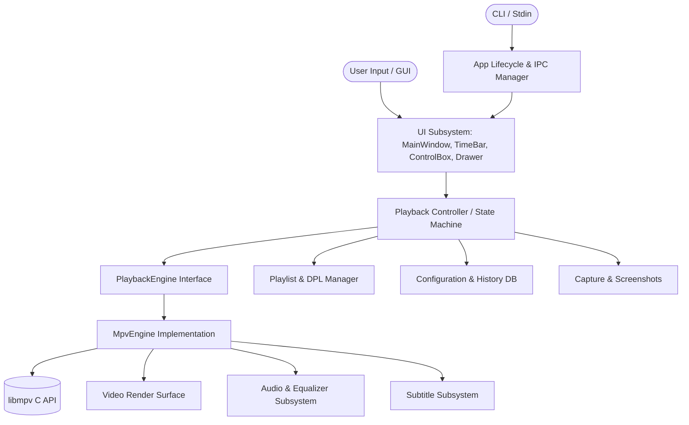

# PotPlayer Native Linux Application Architecture

## 1. Architectural Philosophy

The objective is to build a native, high-performance Linux media player that accurately matches the workflows, interaction density, and functionality of Kakao PotPlayer.

To ensure long-term maintainability, the application strictly decouples the **user interface and application logic** from the **underlying media playback engine**:
- **UI & Presentation**: Modern C++20 with **Qt 6 Widgets**, styled to reflect PotPlayer's signature dark aesthetic.
- **Media Engine**: **libmpv** via its C API (`client.h` and `render_gl.h`), leveraging its mature hardware acceleration (VAAPI, NVDEC, Vulkan), format support, and subtitle rendering.
- **Modularity**: Clearly defined subsystems communicate via Qt signals/slots and abstract interfaces. The UI never interacts directly with raw `mpv_handle` calls.

---

## 2. Subsystem Decomposition & Responsibilities

### `app` (Application Lifecycle & Single-Instance IPC)
- Handles `QApplication` initialization, Wayland/X11 platform integration, and GNOME desktop hooks.
- Parses command-line arguments compatible with `CmdLine64.txt` (`/seek=`, `/sub=`, `/aud=`, `/add`, `/new`, `/current`, etc.).
- Implements single-instance management via `QLocalServer` and `QLocalSocket`. When a second instance is launched with files, it forwards the file paths to the running player and exits (unless `/new` is specified).

### `playback` (Media Engine Abstraction & Playback State)
- Defines abstract `PlaybackEngine` interface:
  - Play, pause, stop, seek (relative & absolute), frame step.
  - Speed adjustment (0.2x to 12.0x), volume (0% to 200%), mute.
  - Property observations: time-pos, duration, pause state, eof, cache-buffering.
- `MpvEngine`: Wraps `mpv_handle` and handles event loop polling via an asynchronous background thread or Qt socket notifier (`mpv_set_wakeup_callback`).
- Emits clean Qt signals (`positionChanged(double)`, `durationChanged(double)`, `stateChanged(PlaybackState)`, `mediaLoaded(MediaInfo)`, `errorOccurred(QString)`).

### `video` (Rendering Surface & Video Processing)
- `VideoWidget`: Custom `QWidget` hosting the video surface:
  - Can use either native X11/Wayland window ID embedding (`wid` property) or `mpv_render_context` over OpenGL (`QOpenGLWidget`).
  - Implements video aspect ratio adjustments (Original, 4:3, 16:9, 16:10, 2.35:1, Stretch).
  - Handles rotation (0, 90, 180, 270 degrees) and horizontal/vertical flip.
  - Manages hardware decoding preferences (`hwdec=auto-safe`, `vaapi`, `nvdec`).
  - Supports color ProcAmp controls: brightness, contrast, saturation, hue, gamma.

### `audio` (Audio Tracks, Output & Equalizer)
- Enumerates available audio tracks with languages and codecs.
- Selects output audio devices via PipeWire / PulseAudio integration.
- Implements 10-band graphic equalizer with preamp slider and classic presets (Rock, Pop, Classical, Flat, Full Bass, Club, Reggae).
- Handles audio delay synchronization in milliseconds.
- Controls channel downmixing and ReplayGain volume normalization.

### `subtitles` (Subtitle Tracks, Styling & Sync)
- Detects and enumerates embedded and external subtitle tracks (SRT, ASS, SSA, VTT, SUB).
- Auto-loads subtitles with matching basenames.
- Manages subtitle delay adjustment in milliseconds.
- Controls subtitle font family, font size, border thickness, shadow, and screen positioning.
- Exposes ASS/SSA styling overrides.

### `playlist` (Playlist & DPL Operations)
- `PlaylistModel`: `QAbstractListModel` for smooth presentation in Qt views.
- Supports native PotPlayer **`.dpl` (Daum Playlist)** files:
  - Parses header `DAUMPLAYLIST`, `playname=`, `playtime=`, `topindex=`, `<n>*file*`, `<n>*title*`, `<n>*duration2*`.
  - Serializes current playlist back to `.dpl`.
- Supports standard M3U and M3U8 playlists.
- Supports playback modes: Repeat None, Repeat Track, Repeat All, Shuffle.
- Provides search and quick filtering.

### `media_library` (History & Bookmarks)
- Manages recently played files list.
- Automatically stores and resumes playback positions (resume playback).
- Stores time-stamped bookmarks per media file.

### `ui` (User Interface & Controls)
- `MainWindow`: Primary window containing:
  - Video render area (`VideoWidget`).
  - Autohiding On-Screen Controls (OSC) on mouse movement.
  - Bottom control bar containing:
    - Transport buttons: Play/Pause, Stop, Prev, Next, Open.
    - Time labels: Elapsed time / Total duration (toggleable between remaining time and elapsed time).
    - Status badges: HW/SW toggle, HDR indicator, Video Codec FourCC, Audio Codec, Channels.
    - Timeline slider (`TimeBar`): interactive seek bar with hover tooltip, chapter marks, and A-B repeat brackets.
    - Volume slider with mute button.
    - Quick panel buttons: Control Box (`F6`), Playlist Drawer (`F8`).
  - Docked / Sliding Playlist Drawer on right side.
- `ControlBox`: PotPlayer's iconic quick settings dialog (`F6`) with tabbed categories:
  - **Playback**: Speed slider, A-B repeat controls, jump intervals.
  - **Video**: Brightness, contrast, saturation, hue, flip/rotate.
  - **Audio**: 10-band equalizer, preamp, voice filter.
  - **Subtitle**: Font size, delay, vertical position.
- `InfoOverlay`: Playback statistics OSD (`Tab` / `Ctrl+F1`) showing resolution, framerate, decoder backend, dropped frames, bitrate, and audio channel info.
- `PreferencesDialog`: Comprehensive settings dialog (`F5`) organized in a hierarchical tree.
- `ContextMenu`: Context menu with complete PotPlayer hierarchy.

### `configuration` (Portable Settings)
- Stores settings in `QSettings::IniFormat` at `~/.config/potplayer-linux/config.ini`.
- Preserves all UI states, window geometry, volume level, renderer preferences, subtitle settings, and recent files.

---

## 3. Data Flow

1. **User Action / CLI Start**:
   The user launches `potplayer-linux media.mp4` or presses Play in the UI.
2. **Controller Mediation**:
   `PlaybackController` intercepts the request, validates the file path, and requests `PlaybackEngine::open(url)`.
3. **Engine Execution**:
   `MpvEngine` invokes `mpv_command_async("loadfile", url)`.
4. **Asynchronous Observation**:
   `libmpv` decodes headers and raises `MPV_EVENT_PROPERTY_CHANGE`.
5. **State Synchronization**:
   `MpvEngine` parses duration, codec name, audio/subtitle tracks, and emits signals to the UI.
6. **UI Update**:
   `MainWindow`, `TimeBar`, badges, and playlist update instantly without blocking the rendering loop.
